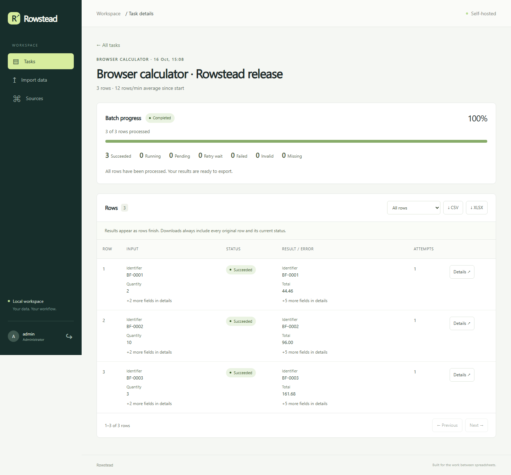

# Rowstead

[](https://github.com/Ivbermaster/rowstead/actions/workflows/ci.yml)

**CSV/XLSX enrichment with durable HTTP and browser workers.**

Upload a spreadsheet, map its columns, review the settings and process every row.
Inspect progress and individual attempts, pause or resume a task, and download
partial or completed results without losing original rows or duplicates.

Rowstead is a self-hosted portfolio application. Its two included processors use
controlled synthetic sources, so the demo works without paid APIs or keys.
It does not look up real companies or scrape arbitrary websites out of the box.



## Start the Docker demo

Requirements: Docker Compose with Linux containers and Python 3.11+ for the small
configuration helper. Run from a source checkout:

```sh
git clone https://github.com/Ivbermaster/rowstead.git
cd rowstead
python scripts/configure.py
docker compose build api
docker compose up -d --no-build --wait
docker compose exec api python -m app.cli create-user admin
```

The helper creates a private `.env` with random session/database secrets. It never
overwrites an existing file or prints secrets. The final command prompts for your
administrator password. The first image build downloads Chromium and its system
libraries; later app/UI changes reuse the dependency layers.

Open [localhost:8000](http://127.0.0.1:8000), sign in, choose **New task**, then
**Use company sample**. Continue through **Map columns** and **Review and start**.
The sample should finish with three successful rows. Download CSV or XLSX to inspect
the enriched data. The separate error-handling sample intentionally finishes with
issues and explains automatic retries, missing records and invalid input.

Only the API publishes a host port, bound to `127.0.0.1`. PostgreSQL, worker and demo
source stay on an internal network. Database/files use persistent named volumes.
Stop services with `docker compose stop`; start them with `docker compose start`.

## What you can do

| Workflow | Behavior |
|---|---|
| Import | UTF-8 CSV or XLSX, worksheet/delimiter selection, 20-row preview and mapping |
| Review | Check file, row count, processor and mappings before processing starts |
| Process | HTTP registry lookup or a real Playwright calculator extracting seven fields |
| Monitor | Search/filter the full task list, inspect attempts, show only rows with issues |
| Control | Pause, resume, cancel, retry failed rows; completed results remain available |
| Recover | Heartbeats, expiring leases and fencing prevent stale workers overwriting results |
| Export | Original columns/order/duplicates plus results, statuses and errors in CSV/XLSX |

Upload limits are 20 MiB and 50,000 data rows, with additional archive and structure
checks. These are product limits, not a measured throughput claim at the maximum.
XLSX formulas are rejected; formula-looking export values are escaped.

[Import preview](docs/screenshots/import.png) ·
[Task list](docs/screenshots/dashboard.png) ·
[Mobile row cards](docs/screenshots/task-mobile.png)

## Example files

The [examples](examples/README.md) directory contains three small CSV scenarios:

- [Successful registry lookup](examples/registry-success.csv): three successful rows.
- [Error handling](examples/registry-issues.csv): five successes plus one missing,
  invalid and permanently failing row, including a duplicate and transient failures.
- [Browser calculator](examples/browser-calculator.csv): three successful calculations.

For a real source, implement and register a source-specific adapter. The demo
adapters accept identifiers/calculator inputs, not arbitrary URLs or uploaded Python.

## Architecture

```text
Web panel / REST API → PostgreSQL queue → independent worker → source adapter
                              ↑                  │
                              └── saved results ─┘
```

Python, FastAPI, SQLAlchemy, Alembic, PostgreSQL, httpx, Playwright and openpyxl;
Jinja2 and browser JavaScript power the panel without a separate frontend build.
PostgreSQL uses `FOR UPDATE SKIP LOCKED` for concurrent claims. SQLite supports a
single-worker local development demo. Redis is not required.

See [architecture and operations](docs/architecture.md) for recovery, adapter
contracts, backup/restore and current operational boundaries.

## Development and tests

[Development setup](docs/development.md) covers local Python/SQLite and environment
settings. Tested dependency versions are pinned in `requirements.lock`.

Use a project virtual environment before installing dependencies:

```sh
python -m pip install -r requirements.lock
python -m pip install --no-deps -e .
python -m ruff check .
python -m pytest -q
```

Enable real browser tests with `BATCHFLOW_E2E=1` after installing Playwright Chromium.
With Compose running, `python scripts/test_postgres.py` executes runtime tests
against its private PostgreSQL using isolated test schemas. Publication-guard
tests run from the source checkout/CI, where Git is available.

Local validation and exact commands are recorded in the [verification report](docs/verification.md).
The [runtime report](docs/runtime-report.md) records an actual 3,000-row HTTP batch,
CSV/XLSX comparison, worker SIGKILL/restart and container Chromium check. Its
shared-host timing and sampled memory are observations, not a production SLA.
The [v0.1.0 GitHub Actions run](https://github.com/Ivbermaster/rowstead/actions/runs/38906034190)
passed: 90 tests, a separate Chromium E2E, SQLite/PostgreSQL migrations and the
container build. See the [first release](https://github.com/Ivbermaster/rowstead/releases/tag/v0.1.0).

## API

Open the local [API reference](http://127.0.0.1:8000/docs) or download the
[OpenAPI JSON](http://127.0.0.1:8000/openapi.json). The reference is self-hosted
and requires no CDN assets.

1. `POST /api/v1/auth/login` with JSON `login` and `password`.
2. Retain the cookie and send the returned `csrf_token` as `X-CSRF-Token` for mutations.
3. `POST /api/v1/imports` with multipart `file`; optional `delimiter` / `sheet_name`.
4. `POST /api/v1/tasks` with `name`, `import_id`, `adapter`, `mapping`.
5. `POST /api/v1/tasks/{id}/start`, then poll task/row state and export.

Mapping is processor field → original column name. Task search accepts `q` and an
exact `status`; row listing supports `issues_only=true` and pagination.
Every task/row/export endpoint is scoped to the signed-in owner.

## Demo capture and operational checks

On an idle synthetic-data Compose stack:

```sh
python scripts/verify_runtime.py
python scripts/verify_backup.py
python scripts/capture_demo.py
```

The runtime harness deliberately kills/restarts only Rowstead's worker. It expects
two worker threads and creates clearly named synthetic tasks. The backup rehearsal
restores into a separate disposable database, compares table contents/file hashes,
and retains the live database. Do not run these checks during other processing.

Runtime/capture helpers read `BATCHFLOW_VERIFY_LOGIN` / `BATCHFLOW_VERIFY_PASSWORD`
from the environment, or a local `BATCHFLOW_ADMIN_PASSWORD` in ignored `.env`.
They never print credentials. Dumps, videos and other local outputs stay in ignored
`artifacts/`; screenshots in this README contain synthetic demo data only.
The optional capture helper creates local material only. Video is not part of this
release, and private runtime artifacts must never be published.

## Contributing, security and license

See [CONTRIBUTING](CONTRIBUTING.md), [SECURITY](SECURITY.md), the
[dependency inventory](docs/dependencies.md) and [release checklist](docs/release-checklist.md).
Before staging a release, run `python scripts/check_release.py --require-git`.
Keep `.env`, databases, uploads, backups and local outputs out of commits.

Rowstead's code is licensed under [MIT](LICENSE). Dependencies and bundled
browser/container components retain their own licenses and notices.

Public hosting, generic external-source configuration, managed retention, browser
session storage and a multi-tenant paid SaaS are outside this demo's current scope.
